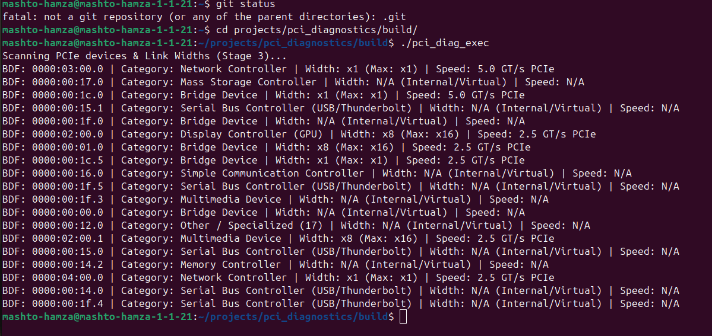
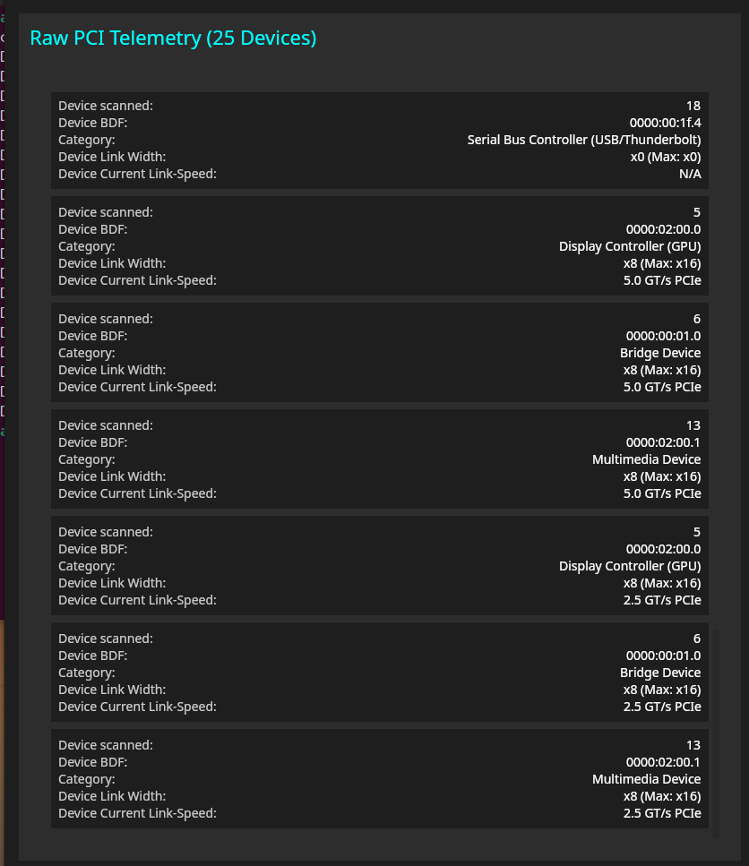

###  PCI Monitor

> High-performance, cross-platform hardware diagnostic and telemetry suite built for enterprise Linux and mobile environments.

---

## 🚀 Visuals & Demo

| C++ Native Engine (`.so` Terminal Output) | Kotlin Multiplatform Desktop App UI |
| :---------------------------------------: | :--------------------------------: |
|  |  |

> *The C++ binary executes low-level direct system calls to read raw PCIe telemetry, while the Kotlin Multiplatform desktop app instantly streams, parses, and renders those exact hardware metrics into a reactive UI.*

---

## 🏗️ Architectural Overview

`PCI_Monitor` is engineered with a clean, decoupled architecture separating low-level hardware diagnostics from the modern multiplatform user interface.

```text
                 ┌─────────────────────────────────────────┐
                 │           PCI_Monitor UI Layer          │
                 │   (Jetpack Compose & Compose Desktop)   │
                 └────────────────────┬────────────────────┘
                                      │
                                      ▼
                 ┌─────────────────────────────────────────┐
                 │           Shared KMP Module             │
                 │   (Business Logic & State Management)   │
                 └─────────┬─────────────────────┬─────────┘
                           │                     │
      (Desktop / Linux)    │                     │    (Android / NDK)
                           ▼                     ▼
              ┌─────────────────────────┐ ┌─────────────────────────┐
              │        JNA Bridge       │ │       Android JNI       │
              └──────────┬──────────────┘ └──────────┬──────────────┘
                         │                           │
                         └─────────────┬─────────────┘
                                       │
                                       ▼
                 ┌─────────────────────────────────────────┐
                 │         C++ Backend Core Engine         │
                 │   (libpci_diag.so - PCI Diagnostics)    │
                 └─────────────────────────────────────────┘
