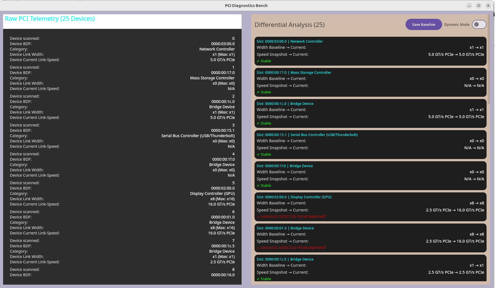
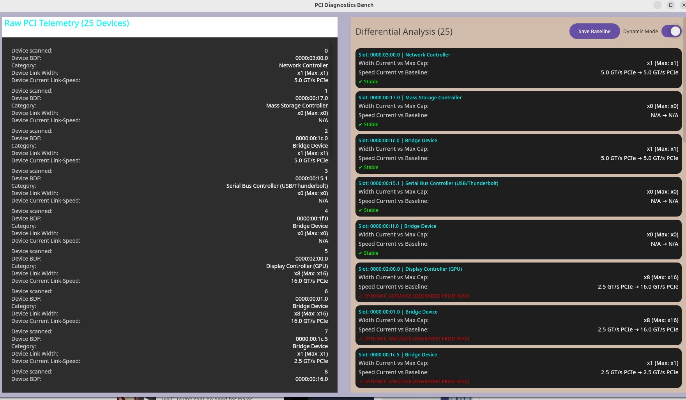

###  PCI Monitor

> High-performance, cross-platform hardware diagnostic and telemetry suite built for enterprise Linux and mobile environments.

---

## 🚀 Visuals & Demo


### Dual-Mode Differential Analysis Views

| Static Baseline Mode |
| :---------------------------------------: |
| 
*Static baseline differential profiling comparing instantaneous PCIe metrics against a point-in-time frozen snapshot to flag state shifts.* |

<br>

| Dynamic Telemetry Mode|
| :---------------------------------------: |
| |
*Dynamic telemetry mode evaluating live link speed and width against maximum hardware rated limits (`maxLinkWidth` / max GT/s).* |

<br>
<br>
 
| C++ Native Engine (`.so` Terminal Output) |
| :---------------------------------------: |
| |
*The C++ binary executes low-level direct system calls to read raw PCIe telemetry, while the Kotlin Multiplatform desktop app instantly streams, parses, and renders those exact hardware metrics into a reactive UI.* 

<br>
<br>
 

### 📊 Telemetry Attribute Glossary
- **Device BDF:** The unique Bus:Device.Function hardware address identifying the PCIe device location on the system bus.
- **Category:** The functional classification of the hardware controller (e.g., GPU, Network, Bridge, or Storage).
- **Device Link Width:** The number of active PCIe lanes allocated for data transfer (e.g., x1, x8, x16).
- **Device Current Speed (GT/s):** The real-time signaling rate and data transfer generation currently negotiated by the link.

---

## 🏗️ Architectural Overview

`PCI_Monitor` is engineered with a clean, decoupled architecture separating low-level hardware diagnostics from the modern multiplatform user interface.

```text
                 ┌─────────────────────────────────────────┐
                 │          PCI_Monitor UI Layer           │
                 │   (Jetpack Compose & Compose Desktop)   │
                 └────────────────────┬────────────────────┘
                                      │
                                      ▼
                 ┌─────────────────────────────────────────┐
                 │           Shared KMP Module             │
                 │   (Business Logic & State Management)   │
                 └─────────┬─────────────────────┬─────────┘
                           │                     │
      (Desktop / Linux)    │                     │    (Android / NDK)
                           ▼                     ▼
                 ┌─────────────────────────┐ ┌─────────────────────────┐
                 │       JNA Bridge        │ │       Android JNI       │
                 └──────────┬──────────────┘ └──────────┬──────────────┘
                            │                           │
                            └─────────────┬─────────────┘
                                          │
                                          ▼
                 ┌─────────────────────────────────────────┐
                 │        C++ Backend Core Engine          │
                 │    (libpci_diag.so - PCI Diagnostics)   │
                 └─────────────────────────────────────────┘
