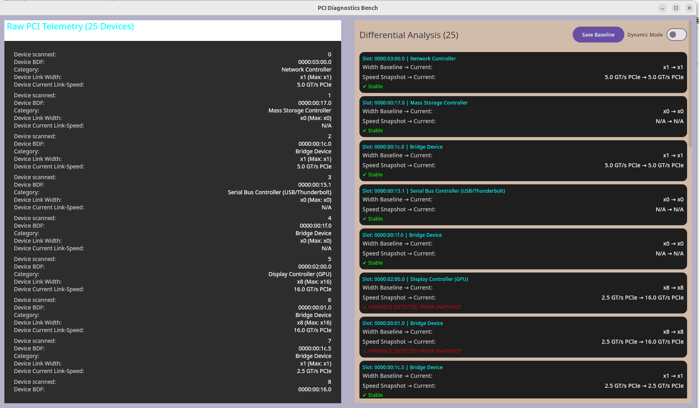
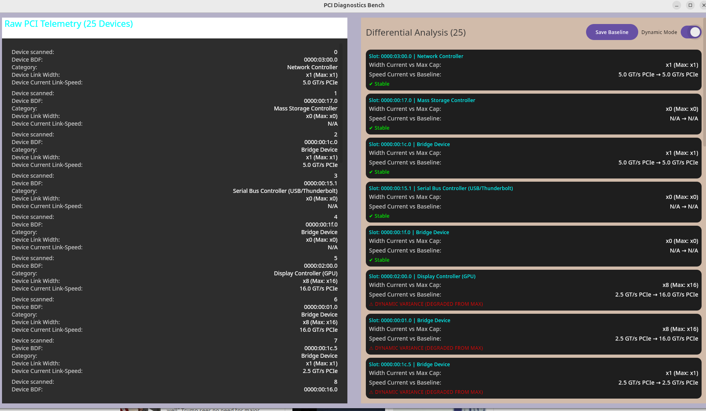
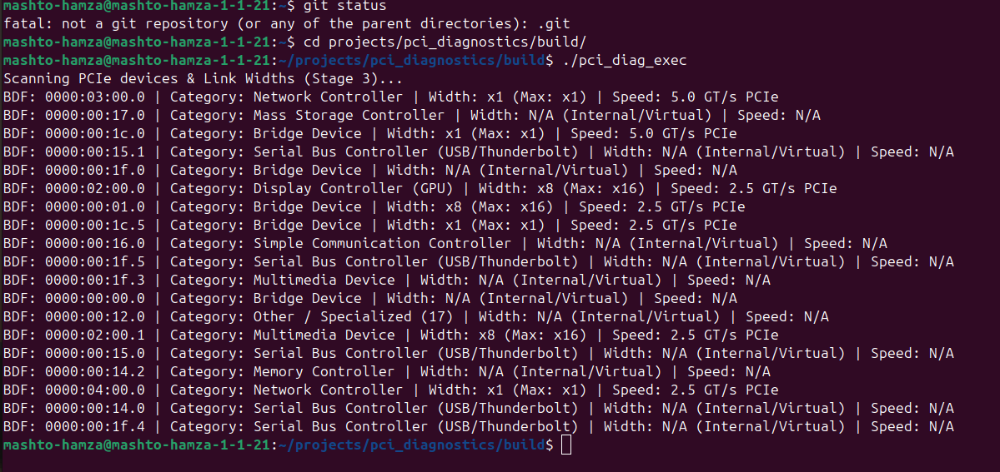

###  PCI Monitor

> High-performance, cross-platform hardware diagnostic and telemetry suite built for enterprise Linux and mobile environments.
>
> - **C++ Native Core:** Host-level diagnostic engine (`libpci_diag.so`) executing direct system calls on target environments (e.g., Ubuntu Linux) for low-level PCIe telemetry.
> - **KMP Desktop Application:** Compose Desktop interface rendering real-time differential hardware diagnostics and point-in-time snapshot baselines locally.
> - **Android Mobile Client (Upcoming):** Lightweight mobile client streaming live hardware telemetry remotely from target host instances.
---
<br>


## 🚀 Visuals & Demo


### Dual-Mode Differential Analysis Views

| Static Baseline Mode |
| :---------------------------------------: |
| 
*Static baseline differential profiling comparing instantaneous PCIe metrics against a point-in-time frozen snapshot to flag state shifts.* |

<br>

| Dynamic Telemetry Mode|
| :---------------------------------------: |
| |
*Dynamic telemetry mode evaluating live link speed and width against maximum hardware rated limits (`maxLinkWidth` / max GT/s).* |

<br>
 
| C++ Native Engine (`.so` Terminal Output) |
| :---------------------------------------: |
| |
*The C++ binary executes low-level direct system calls to read raw PCIe telemetry, while the Kotlin Multiplatform desktop app instantly streams, parses, and renders those exact hardware metrics into a reactive UI.* 

<br>

### 📊 Telemetry Attribute Glossary
- **Device BDF:** The unique Bus:Device.Function hardware address identifying the PCIe device location on the system bus.
- **Category:** The functional classification of the hardware controller (e.g., GPU, Network, Bridge, or Storage).
- **Device Link Width:** The number of active PCIe lanes allocated for data transfer (e.g., x1, x8, x16).
- **Device Current Speed (GT/s):** The real-time signaling rate and data transfer generation currently negotiated by the link.

---
<br>

| PCI(e)-X8 PintOut Reference Diagram|
| :---------------------------------------: |
| _x8.png)
<br>

## 🏗️ Architectural Overview

`PCI_Monitor` is engineered with a clean, decoupled architecture separating low-level hardware diagnostics from the modern multiplatform user interface.

### 1. Standalone Execution Flow (Software Stack)
```text
                 ┌─────────────────────────────────────────┐
                 │          PCI_Monitor UI Layer           │
                 │   (Jetpack Compose & Compose Desktop)   │
                 └────────────────────┬────────────────────┘
                                      │
                                      ▼
                 ┌─────────────────────────────────────────┐
                 │           Shared KMP Module             │
                 │   (Business Logic & State Management)   │
                 └─────────┬─────────────────────┬─────────┘
                           │                     │
      (Desktop / Linux)    │                     │    (Android / NDK)
                           ▼                     ▼
                 ┌─────────────────────────┐ ┌─────────────────────────┐
                 │        JNA Bridge       │ │       Android JNI       │
                 └──────────┬──────────────┘ └──────────┬──────────────┘
                            │                           │
                            └─────────────┬─────────────┘
                                          │
                                          ▼
                 ┌─────────────────────────────────────────┐
                 │         C++ Backend Core Engine         │
                 │    (libpci_diag.so - PCI Diagnostics)   │
                 └─────────────────────────────────────────┘
```
<br>

### 2. Multi-Repository gRPC Architecture & Ecosystem Layout

```mermaid
graph LR
    subgraph MasterRepo ["Master Repository: PCI-Monitor"]
        direction LR
        subgraph Submodule1 ["Submodule 1: pci-backend"]
            direction TB
            cpp_lib["C++ Library (libpci_diag.so)"]
            sysfs_layer["Linux Kernel /sysfs"]
            grpc_server["gRPC C++ Server / Daemon"]
            sysfs_layer -->|Reads devices| cpp_lib
            cpp_lib -->|Wraps telemetry| grpc_server
        end
        subgraph Submodule2 ["Submodule 2: pci-kmp-ui"]
            direction TB
            kmp_client["KMP UI Core (Compose)"]
            grpc_android_client["gRPC Android Client"]
            grpc_android_client -->|Emits Flow| kmp_client
        end
    end
    grpc_android_client ==>|gRPC Stream over TCP/IP| grpc_server
    subgraph TargetUbuntu ["Ubuntu Host"]
        ubuntu_os[Ubuntu OS & Kernel]
        ubuntu_daemon[gRPC Server Daemon]
        ubuntu_so[libpci_diag.so]
        ubuntu_os -.- ubuntu_daemon
        ubuntu_daemon -.- ubuntu_so
    end
    grpc_server -.->|Runs inside| ubuntu_daemon
    classDef master fill:#f3e5f5,stroke:#7b1fa2,stroke-width:2px;
    classDef sub fill:#e3f2fd,stroke:#1565c0,stroke-width:2px;
    classDef transport fill:#fff9c4,stroke:#fbc02d,stroke-width:2px;
    classDef target fill:#e8f5e9,stroke:#2e7d32,stroke-width:2px;
    class MasterRepo master;
    class Submodule1,Submodule2 sub;
    class grpc_android_client transport;
    class TargetUbuntu target;              
